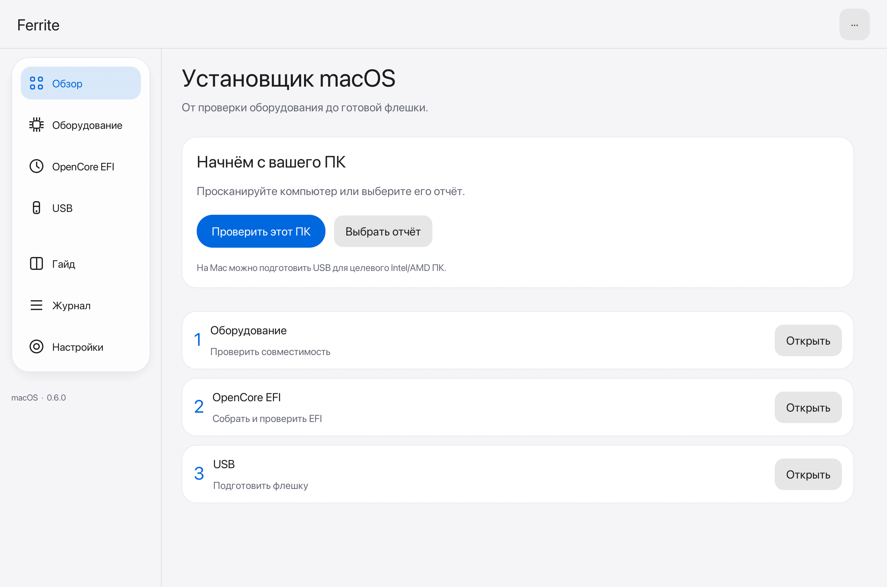

# Ferrite

Подготовка OpenCore и установочного USB для macOS: проверка оборудования, сборка EFI, загрузка Apple Recovery и проверка записанных файлов. Нативное приложение на Rust для Linux, Windows и macOS. Интерфейс на русском, английском и испанском.

**Версия 0.6.0 — preview.** Ferrite помогает подготовить установщик; совместимость ноутбука и успешную установку macOS нужно проверять на реальном железе.



В 0.6.0 интерфейс обновлён в стиле Apple: крупные заголовки, мягкие карточки, лёгкая навигация и меньше текста. Оформление — системное, светлое или тёмное; выбор сохраняется. Проверка оборудования, сборка EFI и подготовка USB собраны в три понятных этапа. Подробная диагностика и дополнительные настройки раскрываются по необходимости.

[Тёмная тема и другие экраны](docs/ferrite/UI.md).

## Скачать и запустить

Готовые сборки публикуются в [Releases](https://github.com/notnotshuts/1401/releases). Выбирайте релиз с названием **Ferrite**: прежние релизы `linux-*` относятся к старому Python-приложению. Если новая сборка ещё выполняется, её состояние видно в [Actions → Ferrite Rust](https://github.com/notnotshuts/1401/actions/workflows/ferrite.yml).

| Система | Файл | Запуск |
|---|---|---|
| Linux x86_64 | `Ferrite-0.6.0-linux-x86_64.tar.gz` | Распакуйте архив, запустите `./ferrite` |
| Windows x86_64 | `Ferrite-0.6.0-windows-x86_64.zip` | Распакуйте архив, откройте `ferrite.exe` |
| macOS 12+, Apple Silicon | `Ferrite-0.6.0-aarch64.dmg` | Откройте DMG и перенесите Ferrite в Applications |
| macOS 12+, Intel | `Ferrite-0.6.0-x86_64.dmg` | Откройте DMG и перенесите Ferrite в Applications |

На Linux и Windows держите **`ferrite` и `ferrite-cli` рядом**: GUI использует CLI для привилегированной записи USB. Python, .NET и Rust для запуска готовой программы не нужны.

На Linux Mint/Ubuntu установите инструменты ACPI и запроса прав:

```bash
sudo apt update
sudo apt install acpica-tools policykit-1 libxkbcommon-x11-0
# Выполните в папке распакованного архива:
./ferrite
```

На Windows для сборки EFI нужен ACPICA `iasl.exe`: укажите путь к нему в дополнительных настройках сборки. На macOS установите `iasl` командой `brew install acpica`. DMG подписывается локальной ad-hoc подписью; Developer ID и notarization пока нет.

## Подготовить установщик

1. **Оборудование.** Нажмите «Сканировать этот ПК» или импортируйте `Report.json` с целевого компьютера. Для чужого ПК нужны его собственные отчёт и ACPI. Выберите версию macOS и изучите ограничения оборудования.
2. **ACPI.** Сканирование пытается сохранить таблицы автоматически. Если они недоступны, импортируйте полный дамп с DSDT. В Linux можно отдельно снять таблицы через CLI с правами администратора.
3. **Сборка EFI.** Выберите папку ACPI и путь к `iasl`, затем соберите EFI. Ferrite скачает закреплённые компоненты, проверит SHA-256 и запустит `ocvalidate`. Продолжайте после успешной проверки. Сборка содержит `BIOS.txt` с настройками для проверки перед загрузкой.
4. **Apple Recovery.** Нажмите «Далее: скачать Apple Recovery». Дождитесь загрузки и проверки подписи chunklist и всех блоков образа.
5. **Установка и USB.** Подключите флешку 8–128 GiB, обновите список, сверьте модель и размер. Введите точный путь выбранного диска и подтвердите запись. **Все данные на выбранной флешке будут удалены.** GUI запрашивает повышенные права только для записи.
6. **Первая загрузка.** Выберите флешку в UEFI Boot Menu, затем Recovery в OpenCore. Для установки через Recovery нужен интернет. Перед стиранием диска в установщике проверьте, что выбран нужный накопитель.

На **macOS доступна прямая запись USB** с системным запросом прав администратора. Приложение проверяет IOKit-идентичность, удерживает накопитель через Disk Arbitration, размонтирует его тома и блокирует повторное монтирование во время записи. После проверки файлов флешка безопасно извлекается; для просмотра EFI подключите её снова. Внутренние диски и физические хранилища системного APFS заблокированы. Если том занят, закройте использующие его программы; принудительное размонтирование не применяется. Также доступно создание файла образа. На Apple Silicon Ferrite готовит EFI для целевого Intel/AMD ПК; macOS для ARM Mac таким способом не устанавливается.

Подробный [гайд на русском](docs/ferrite/Guide-ru.md), [English](docs/ferrite/Guide-en.md), [Español](docs/ferrite/Guide-es.md) также доступен внутри программы.

## Где находятся результаты

| Система | Рабочая папка по умолчанию |
|---|---|
| Linux | `${XDG_DATA_HOME:-~/.local/share}/ferrite` |
| Windows | `%LOCALAPPDATA%\Ferrite` |
| macOS | `~/Library/Application Support/Ferrite` |

Папку можно сменить в настройках. Отчёты сохраняются в отдельные `session-*`; результаты сборки содержат EFI, `BIOS.txt` и `build-result.json`. Операции сборки, загрузки Recovery и создания образа требуют новых выходных путей и не заменяют существующие результаты.

## Если возникла ошибка

| Проблема | Что проверить |
|---|---|
| Не удалось собрать EFI | Полный дамп ACPI с DSDT, установленный `iasl`, сообщение во вкладке «Журнал» |
| Компьютер или GPU несовместимы | Причину в разделе оборудования; успешная проверка plist не добавляет поддержку GPU |
| USB отсутствует или заблокирован | Обновите список, посмотрите причину блокировки. Системный диск, неподходящий размер или неизвестная идентичность не допускаются к записи |
| USB занят | Закройте окна флешки и терминалы внутри неё; выйдите командой `cd ~`, затем повторите операцию |
| Ошибка `wrong fs` при ручном монтировании | Монтируйте раздел, например `/dev/sda1`, а не весь `/dev/sda`; сначала определите его через `lsblk -f` |
| Recovery не загружается | Проверьте соединение и журнал. Подпись и хеши должны пройти проверку; их проверку отключать не нужно |
| Зависание после OpenCore | Сохраните фото последней строки, `opencore-*.txt` и текущую папку EFI; проверьте BIOS по гайду. Одной последней строки обычно недостаточно для диагноза |

При сообщении об ошибке приложите версию Ferrite, ОС, модель ПК и журнал. Из отчёта и EFI перед публичной публикацией удалите личные серийные номера. Для обращения используйте [Issues](https://github.com/notnotshuts/1401/issues).

## CLI

В примерах `ferrite-cli` доступен в PATH; из распакованной папки Linux используйте `./ferrite-cli`.

```bash
# Отчёт и попытка сохранить ACPI в новую сессию:
ferrite-cli snapshot ./sessions
# Linux: отдельный дамп ACPI, если обычному пользователю не хватает прав:
sudo ./ferrite-cli capture ./ACPI

# Используйте реальный путь к сохранённому Report.json:
ferrite-cli check ./Report.json --darwin 24
ferrite-cli plan ./Report.json --darwin 24
ferrite-cli build ./Report.json ./ACPI ./new-build --darwin 24 --iasl iasl
ferrite-cli recovery ./new-recovery --darwin 24
ferrite-cli image ./new-build ./new-recovery ./installer.img --size-gib 8
ferrite-cli disks
ferrite-cli --language ru guide ./Guide.md
ferrite-cli --help
```

`--darwin 24` соответствует macOS Sequoia. Команда `image` создаёт новый файл, а не стирает физический диск. Для физической записи проще использовать GUI с выбором и подтверждением накопителя.

Для существующей EFI есть `audit` и `repair`. Без доверенного `ocvalidate` аудит выполняет только структурные проверки. `repair` создаёт отдельную копию и не подтверждает её загрузку:

```bash
ferrite-cli audit ./EFI --validator ./ocvalidate --validator-sha256 SHA256_ВАЛИДАТОРА
ferrite-cli repair ./EFI ./EFI-repaired
```

## Собрать из исходников

Установите Rust через rustup; `rust-toolchain.toml` закрепляет **1.99.0**. Нужны Git и системный C/C++ toolchain.

Linux Mint/Ubuntu:

```bash
sudo apt install build-essential pkg-config libx11-dev libxi-dev libxcursor-dev \
  libxrandr-dev libxinerama-dev libwayland-dev libxkbcommon-dev libxkbcommon-x11-dev libgl1-mesa-dev acpica-tools
```

Windows: Visual Studio Build Tools с C++ и Rust MSVC. macOS: Xcode Command Line Tools (`xcode-select --install`). Затем на любой из трёх платформ:

```bash
git clone https://github.com/notnotshuts/1401.git
cd 1401
cargo build --release --workspace --locked
cargo run --locked -p ferrite-desktop
```

GUI и CLI появятся в `target/release`. Для macOS-пакета:

```bash
python3 tools/macos/package.py --target native
# Один DMG для Intel и Apple Silicon:
python3 tools/macos/package.py --target universal
```

Проверки и упаковка Linux/Windows:

```bash
cargo fmt --all --check
cargo clippy --workspace --all-targets --locked -- -D warnings
cargo test --workspace --locked
python3 tools/package.py --platform linux  # на Windows: --platform windows
```

Actions выполняет проверки, release-компиляцию и упаковку для всех четырёх целей. После успешного push в `main` архивы, DMG и `SHA256SUMS` публикуются в отдельном preview-релизе Ferrite.

## Структура проекта

```text
crates/
  ferrite-core/       сканирование, совместимость, EFI, Recovery и USB
  ferrite-cli/        команды и отдельный привилегированный writer
  ferrite-desktop/    графический интерфейс egui
docs/ferrite/        гайды, скриншоты и статус проверок
licenses/           сохранённые лицензии источников данных
tools/              упаковщики и экспорт таблиц для разработчиков
.github/workflows/  сборка и публикация Ferrite
```

Rust-тесты находятся рядом с модулями. Таблицы и переводы встроены при компиляции. Старые Python/C#/EFI-loader реализации удалены из текущего дерева; их можно найти в истории Git.

## Что пока не проверено

Перенос специальных правил OpCore-Simplify ещё не завершён: сложные ноутбучные ACPI-патчи, USB mapping, MUX/панели и некоторые GPU требуют отдельной работы. NVIDIA companion в новый процесс установки не перенесён. Запуск меню OpenCore в QEMU и успешный `ocvalidate` не подтверждают установку macOS или работу всех устройств.

[Статус переноса](docs/ferrite/MIGRATION.md) · [Протокол проверок](docs/ferrite/VALIDATION.md)

## Лицензия и источники

Независимый форк [1401](https://github.com/nullmoth/1401). Код проекта — [PolyForm Noncommercial 1.0.0](LICENSE); данные и адаптированные правила сохраняют лицензии своих авторов. Источники и уведомления перечислены в [NOTICE.md](NOTICE.md). Apple Recovery скачивается отдельно с серверов Apple и не входит в репозиторий.
