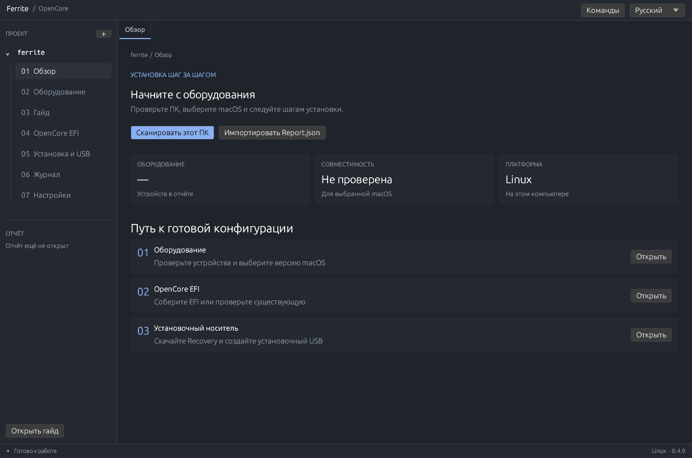
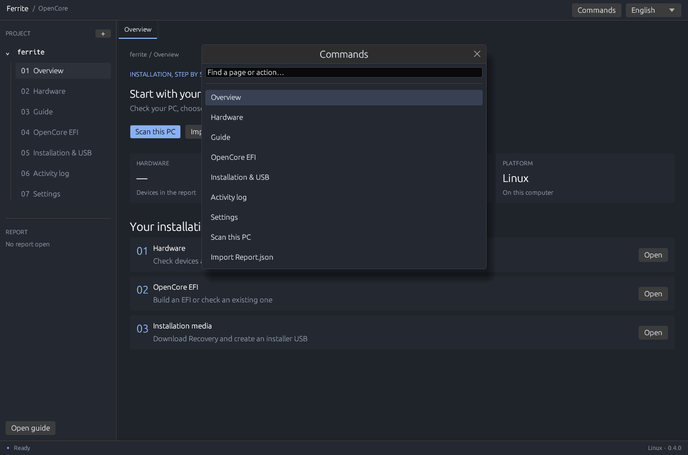

# Ferrite

Новый Rust-движок проекта 1401 для Windows, Linux и macOS. **0.4.0 preview**: полный основной процесс от отчёта до проверенного установочного образа; перенос всех специальных правил OpCore-Simplify ещё не завершён.




## Интерфейс 0.4

Компактный интерфейс в духе Zed/One Dark: боковая панель проекта с регулируемой шириной, вкладки, тонкие границы, синяя подсветка и нижняя строка состояния. Палитра команд открывается Ctrl+Shift+P (на Mac — Cmd+Shift+P); доступны поиск, стрелки, Enter и Esc. Ctrl/Cmd+W закрывает текущую вкладку. Сохранены русские, английские и испанские тексты.

## macOS

macOS 12+; Intel и Apple Silicon. Поддерживаются импорт отчёта другого ПК, проверка совместимости, сборка/аудит EFI, Recovery, файл установочного образа, гайд и журнал. Сканер использует системные system_profiler, sysctl и IORegistry, список накопителей — read-only diskutil. Пути данных и настроек: `~/Library/Application Support/Ferrite`.

На Apple Silicon создаётся EFI **для целевого Intel/AMD ПК**, а не для самого ARM Mac. Нужны Report.json и ACPI этого ПК. ACPI с самого Mac доступна только если прошивка предоставляет таблицы; отсутствие DSDT обозначается явно.

Для сборки установите Rust 1.99.0 и Xcode Command Line Tools. Для ACPI: `brew install acpica`. При запуске из Finder приложение проверяет стандартные Homebrew пути к iasl. Утилиты macserial/ocvalidate выбираются из macOS-пакета; закреплённый OpenCore содержит Intel+ARM universal binaries.

```bash
cargo build --release --locked --workspace
python3 tools/macos/package.py --target native
# Один .app/DMG для Intel и Apple Silicon:
python3 tools/macos/package.py --target universal
```

Упаковщик создаёт `.app` с GUI, CLI, лицензиями и гайдами, а также DMG с ярлыком Applications. Он выполняет локальную ad-hoc подпись, которая не заменяет Developer ID/notarization. CI содержит отдельные проверки Intel и Apple Silicon. В текущей Linux-среде нативный запуск macOS и создание DMG не выполнялись: для этого нужен Apple SDK и Mac.

**Прямая запись физических USB на macOS пока отключена.** Доступно создание файла образа; Windows/Linux writer сохраняется. Не включайте запись на Mac до реализации и проверки эксклюзивной блокировки физических дисков.

## Языки и гайд

Русский, English и Español переключаются в правом верхнем углу или в настройках. Выбор сохраняется для следующего запуска. Переводы интерфейса и гайда находятся в `crates/ferrite-core/locales/ru.json`, `en.json` и `es.json`. Файлы встроены в приложение при сборке.

Откройте «Гайд»: шесть шагов от проверки оборудования до первого запуска, ручной чек-лист BIOS, кнопки перехода к нужным страницам и список проверок после установки. «Сохранить гайд» создаёт Markdown на текущем языке в рабочей папке. Подробные сообщения диагностических инструментов доступны отдельно и могут сохранять язык источника.

```bash
ferrite-cli --language en guide ./Guide-en.md
ferrite-cli --language es guide ./Guide-es.md
ferrite-cli --language ru guide ./Guide-ru.md
```

Команда создаёт новый файл и не перезаписывает существующий. `--language` также выбирает язык BIOS-гайда при сборке EFI.

## Изменения

- Нативный интерфейс egui: обзор, оборудование, сборка/проверка EFI, Recovery, накопители и журнал. Долгие операции выполняются в фоне с прогрессом.
- Rust-сканер Linux использует proc/sysfs; Windows — SetupAPI, CPUID, SMBIOS и Win32. Python и PowerShell не запускаются новым приложением.
- Импорт Hardware Sniffer Report.json, проверка размера/хеша и совместимости CPU/GPU/storage/network/audio/Bluetooth/SD.
- Закреплённые таблицы OpCore-Simplify: каталог kexts, зависимости/конфликты, CPU, SMBIOS и audio layouts. Выбор версии macOS, SMBIOS, Wi-Fi, audio layout и устройств.
- Сборка EFI из архивов с проверкой SHA-256: kexts/плагины, драйверы, серийные номера, config.plist, AMD patches, базовые SSDT. Нативный iasl компилирует ACPI. ocvalidate из того же OpenCore-пакета обязателен.
- Apple Recovery: Rust-протокол, проверка RSA-подписи chunklist и каждого блока, продолжение прерванного потока. Токены не экспортируются.
- Создание MBR/FAT32 установочного образа и проверка записанных файлов. Физический USB writer реализован через Linux/Win32 с отдельным привилегированным CLI, проверкой идентичности и блокировкой системных дисков.
- Аудит существующей EFI и ремонт в отдельную копию. Исходные папки не перезаписываются.

## Сборка

Rust 1.99.0. Linux (Debian/Ubuntu):

```bash
sudo apt install build-essential pkg-config libx11-dev libxi-dev libxcursor-dev \
  libxrandr-dev libxinerama-dev libwayland-dev libxkbcommon-dev libgl1-mesa-dev acpica-tools
cargo build --release --locked --workspace
cargo run --locked -p ferrite-desktop
```

Windows: Rust MSVC и Visual Studio Build Tools с C++. Команды Cargo те же. Для генерации ACPI установите ACPICA iasl и укажите путь в интерфейсе. Держите ferrite-cli рядом с ferrite: он нужен для записи USB. Linux writer использует PolicyKit/pkexec; GUI работает без root.

## CLI

```bash
ferrite-cli snapshot ./sessions
ferrite-cli check ./Report.json --darwin 24
ferrite-cli plan ./Report.json --darwin 24
ferrite-cli build ./Report.json ./ACPI ./new-build --darwin 24 --iasl iasl
ferrite-cli recovery ./new-recovery --darwin 24
ferrite-cli image ./new-build ./new-recovery ./installer.img --size-gib 8
ferrite-cli disks
ferrite-cli audit ./EFI --validator ./ocvalidate --validator-sha256 TRUSTED_SHA256
ferrite-cli repair ./EFI ./EFI-repaired
```

Darwin 24 = macOS Sequoia. Выходные папки сборки/Recovery и файл образа должны быть новыми. Для физической записи выберите накопитель в GUI и введите его точный путь. Writer стирает диск; поддерживает 8–128 GiB, логический сектор 512 байт и FAT32 (файл до 4 GiB). Не выбирайте диск с нужными данными.

## Проверено и ограничения

[Протокол проверки](docs/ferrite/VALIDATION.md): реальные EFI/ocvalidate, Apple Recovery, установочный образ, OpenCore в QEMU. Физическая запись USB и запуск на реальном Windows ПК ещё не проверены. Проверка ocvalidate подтверждает формат конфигурации, а не работу всего оборудования.

Не все персональные ноутбучные ACPI-патчи, iGPU/MUX/панели, USB mapping, NVIDIA companion и специальные настройки перенесены. Tahoe может потребовать отсутствующий в закреплённых архивах компонент. При неопределённых путях ACPI сборка останавливается. Нет подписанных установщиков или автоматического обновления. [Статус переноса](docs/ferrite/MIGRATION.md).

## Разработка и лицензии

```bash
cargo fmt --all --check
cargo clippy --workspace --all-targets --locked -- -D warnings
cargo test --workspace --locked
```

Workspace: ferrite-core, ferrite-cli, ferrite-desktop. Legacy p1401/upstream/windows/linux остаются эталоном, но новый runtime их не запускает. Инструменты Python в tools предназначены разработчикам.

Независимый форк [1401](https://github.com/nullmoth/1401), лицензия [PolyForm Noncommercial 1.0.0](LICENSE). Данные OpCore-Simplify/Hardware Sniffer сохраняют BSD-3-Clause и уведомления [NOTICE.md](NOTICE.md). Ferrite не использует фирменный знак NullMoth. Apple Recovery загружается отдельно с серверов Apple и не входит в исходники. [Прежняя документация](docs/ferrite/1401-LEGACY.md).
