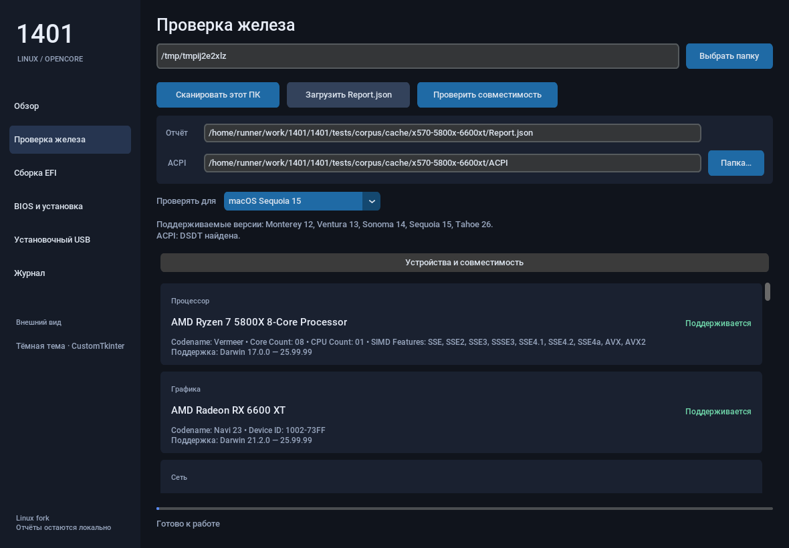

# 1401 Linux

Приложение для проверки совместимости ПК с macOS, сборки OpenCore EFI и создания установочного USB из Linux. Интерфейс на **CustomTkinter**, аппаратные проверки — из закреплённой версии **OpCore-Simplify**.

[](https://github.com/notnotshuts/1401/actions/workflows/linux-build.yml)

Это независимый Linux-форк [nullmoth/1401](https://github.com/nullmoth/1401). Целевая платформа — **x86_64 Linux**; пакеты и интеграционные проверки собираются на Ubuntu 22.04. Исходный Windows-интерфейс сохранён в `windows/`.



## Возможности

- **Проверка железа:** CPU, GPU, сеть, звук, контроллеры дисков, Bluetooth, картридеры и биометрия. Показ идентификаторов, диапазонов macOS, статусов поддержки и требований OCLP / NVIDIA-драйвера.
- **Сканирование ПК:** Hardware Sniffer собирает `Report.json` и ACPI. Можно импортировать существующий отчёт и указать отдельную папку ACPI.
- **Сборка EFI:** общий движок 1401 применяет свои политики поверх OpCore-Simplify. Интерфейс показывает SMBIOS, kexts, отключённые устройства и результат `ocvalidate`.
- **Руководство BIOS:** шаги для собранной конфигурации отображаются в приложении и сохраняются в файл.
- **Установочный USB:** выбор диска с моделью, размером и серийным номером; запрет записи на системные диски; подтверждение точным путём `/dev/...`; проверка файлов после записи.
- **Журнал и рабочие пространства:** операции выполняются в фоновых процессах, результаты сохраняются локально; журнал можно экспортировать.

## Установка

Откройте [последний Linux-релиз](https://github.com/notnotshuts/1401/releases/latest). В разделе **Assets** доступны `.deb`, переносимый `.tar.gz`, `SHA256SUMS`, скриншоты, инструкции и лицензии. Скачайте нужный пакет; распаковывать артефакт Actions больше не требуется.

Для Ubuntu 22.04+ / Debian 12+:

```bash
# В папке со скачанными файлами релиза
# Для проверки всего манифеста скачайте все файлы из Assets
sha256sum -c SHA256SUMS
sudo apt install ./p1401-linux_*_amd64.deb
1401 gui
```

CustomTkinter и его зависимости включены в пакет с фиксированными версиями и SHA-256. Устанавливать их через `sudo pip` не нужно. Системные зависимости, включая Tk, `iasl` и инструменты записи дисков, устанавливает пакетный менеджер.

Для других дистрибутивов используйте переносимый архив; список системных зависимостей приведён в [docs/LINUX.md](docs/LINUX.md).

## Как пользоваться

1. На странице **Обзор** нажмите **Подготовить всё автоматически**. Приложение сканирует ПК, проверит совместимость, подберёт версию при необходимости, соберёт EFI и откроет личный гайд. Сканирование запросит пароль администратора; сборка выполняется без root.
2. Прочитайте **BIOS и установка**: там настройки из вашей EFI, шаги загрузки и установки, а также решения типичных проблем. Гайд сохраняется в `BIOS.txt` — сфотографируйте его перед перезагрузкой.
3. Нажмите **Далее: выбрать USB →**, выберите флешку и **Очистить и записать USB**. Подтвердите её путь. **Все данные на выбранном USB будут удалены.** После проверки записи приложение покажет следующий шаг.

Для другого ПК загрузите его `Report.json` в **Проверка железа** и выберите соответствующую папку ACPI с DSDT, затем запустите автоматическую подготовку. Можно вручную выбрать macOS; кнопка **Выбрать рекомендуемую** возвращает подходящую версию. Автоматический подбор сохраняет выбранную совместимую версию, предпочитает обычную поддержку OCLP и при необходимости выбирает Sequoia или новейшую доступную версию.

Проверка учитывает реальные диапазоны отдельных GPU и контроллеров с дисками: OCLP для Wi-Fi не делает неподдерживаемую видеокарту совместимой. Если сведения о дисках отсутствуют, повторите сканирование с правами администратора. Изменение отчёта, ACPI или версии блокирует использование старых результатов.

Если PolicyKit недоступен или запущен переносимый архив, приложение копирует команду `sudo 1401 ...` в буфер обмена для запуска в терминале. EFI можно собирать обычным пользователем.

Результаты находятся в выбранной рабочей папке: `scan/`, `compatibility.json`, `build/`, `build-result.json`, `BIOS.txt`. Отчёты и журналы автоматически никуда не отправляются.

## Если сканирование остановилось

В версии **1.2.2** исправлена проверка ACPI-путей системных устройств: температурные зоны `\_TZ_.TZ0_`, процессоры `\_PR.CPU0` и корень пространства имён больше не вызывают ложную ошибку отчёта. Журнал показывает версию приложения и схему проверки, чтобы отличать старый запущенный экземпляр после обновления.

Проверка также предупреждает о встроенных панелях eDP/LVDS, подключённых к неподдерживаемой графике. Для такой конфигурации поддержка NVIDIA-драйвера не подтверждает работу экрана: необходима проверка аппаратного MUX или выхода, физически подключённого к NVIDIA.

Также включены исправления 1.2.1: повторное сканирование, доступ к созданным через sudo/PolicyKit файлам, импорт JSON с BOM и пропущенными пустыми разделами, сбор CPU и мониторов. Сканирование каждый раз создаёт новую папку `scans/scan-…`; результаты старых запусков не подменяют новый отчёт.

- Установите свежий `.deb` поверх предыдущего пакета и перезапустите приложение обычным пользователем.
- Нажмите **Сканировать этот ПК**. Существующие отчёты сохранятся. Если сканирование частичное, интерфейс покажет созданный отчёт и конкретные ошибки; для EFI нужна DSDT.
- Для другого ПК импортируйте его `Report.json` и папку ACPI. Файл отчёта не содержит ACPI: одной JSON недостаточно для EFI. Мастер не заменяет импортированный отчёт сканированием текущего ПК.
- Если пароль не запрашивается, проверьте работу PolicyKit в сеансе рабочего стола. Команда для ручного запуска копируется в буфер при недоступном помощнике.
- При сбое сохраните **Журнал**: теперь причина выводится и в интерфейсе. Поддерживаемое по правилам железо всё равно требует проверки реальной загрузки.

CI проверяет пакеты на Ubuntu 22.04 и 24.04 (базы Mint 21/22), запускает установленный сканер и весь мастер с настоящими дочерними процессами. Отчёт/ACPI для проверки EFI закреплён в тестовом корпусе; Actions VM не заменяет физический ПК пользователя.

## Apple Recovery и проверка установочного USB

Версия **1.2.3** обращается за сессией и метаданными восстановления по HTTPS. При HTTP 401/403 сессия обновляется один раз. Если Apple или сеть продолжает отказывать, приложение сообщает причину; диск ещё не очищен. Файлы восстановления поступают по адресам Apple и проверяются по подписи chunklist и хешам всех блоков перед форматированием USB.

Перед выпуском Actions выполняет полный тест установленного приложения: импорт JSON → проверка → EFI → гайд → подтверждение записи → загрузка настоящего Recovery с Apple → запись виртуального USB → повторная проверка файлов → загрузка до меню восстановления OpenCore в QEMU/OVMF. Тест использует закреплённый отчёт x570/5800X/6600XT, а не железо пользователя. Производственная защита продолжает запрещать loop-диски; адаптер существует только в тестах и проверяет принадлежность образа.

Скачайте **installer-evidence.zip** из релиза: там скриншоты каждого шага, экран UEFI, журнал, JSON результатов и SHA256SUMS. Для скриншота меню только тестовая копия EFI получает `Timeout=0`, Builtin picker и serial debug. Образ Recovery и содержимое виртуального диска остаются временными файлами CI. Загрузка ядра macOS и физический USB требуют проверки на реальном ПК.

## CLI

```bash
sudo 1401 scan /path/to/work/scan
1401 check /path/to/work/scan/Report.json --macos 24 --output /path/to/work/compatibility.json
1401 build /path/to/work/scan/Report.json /path/to/work/scan/ACPI /path/to/work/build \
  --macos 24 --result /path/to/work/build-result.json
1401 guide /path/to/work/scan/Report.json /path/to/work/build /path/to/work/BIOS.txt
1401 disks
sudo 1401 write /dev/sdX /path/to/work/build \
  --profile /path/to/work/scan/Report.json --darwin 24 --confirm-erase /dev/sdX
```

CLI принимает **Darwin major**: 23 = Sonoma 14, 24 = Sequoia 15, 25 = Tahoe 26. В интерфейсе отображаются названия macOS. Команда `check` проверяет совместимость без ACPI-компиляции и скачивания компонентов; `build` дополнительно проверяет таблицы ACPI и готовую EFI.

## Что означают результаты

| Статус устройства | Значение |
|---|---|
| Поддерживается | Правила движка допускают устройство для выбранной macOS; дополнительные kexts могут потребоваться |
| NVIDIA-драйвер | Применена политика 1401 для поддерживаемой карты NVIDIA и macOS Sequoia; используется отдельный драйвер |
| Нужен OCLP | Для выбранной версии движок указывает поддержку через OpenCore Legacy Patcher |
| Не поддерживается | Выбранная macOS вне известного диапазона либо устройство отклонено движком |
| Не проверено правилами | Для этого устройства нет оценки; это не подтверждение совместимости |

Аппаратная совместимость по таблицам **не гарантирует загрузку и работу macOS**. ACPI, разводку дисплея, USB-порты и работу драйверов необходимо проверить на конкретном ПК. Windows-only native diagnostics пока не портированы. CI проверяет запись на временном loop-образе; физическая флешка и установка macOS в рамках CI не тестируются.

Для NVIDIA после установки macOS требуется [Mac companion и драйвер upstream](https://github.com/nullmoth/nvidia-macos-driver). Linux-порт сохраняет исходные правила 1401; подробнее об устройстве движка — [HOW-IT-WORKS.md](docs/HOW-IT-WORKS.md), об upstream-версии — [исходный README](docs/UPSTREAM-README.md).

## Автоматические релизы

Каждый успешный push в `main` автоматически создаёт Linux-релиз с тегом `linux-<commit>` и всеми файлами. Ручной запуск workflow на `main` делает то же самое. Публикация начинается после всех проверок; pull request и ветка `linux-port` только собираются. Повторный запуск того же коммита не создаёт дубликат релиза. Сначала файлы загружаются в черновик, затем релиз публикуется целиком; актуальная версия помечается **Latest**.

## Разработка и сборка

```bash
python3 -m venv .venv
. .venv/bin/activate
pip install --require-hashes --no-deps -r linux/requirements.txt
python3 -m unittest discover -s tests -v
python3 -m p1401.linux gui

# На Linux: подготовить зависимости и собрать пакеты
python3 -m pip install --require-hashes --no-deps --target build/linux-vendor -r linux/requirements.txt
python3 tools/linux_release.py --output dist/linux --vendor build/linux-vendor
```

[Workflow Linux build and verification](.github/workflows/linux-build.yml) проверяет тесты, форматирование loop-образа, установку `.deb`, переносимый запуск, CustomTkinter-интерфейс под Xvfb, проверку железа, сборку EFI по закреплённому отчёту реального ПК и повторную проверку этой EFI под root.

## Лицензии

Исходный проект — [PolyForm Noncommercial 1.0.0](LICENSE). Лицензии сторонних компонентов перечислены в [NOTICE.md](NOTICE.md); CustomTkinter — MIT. Этот форк не предоставляет прав на брендинг NullMoth и не является официальной версией NullMoth Systems. Apple software не входит в пакет; образ восстановления загружается с серверов Apple.
