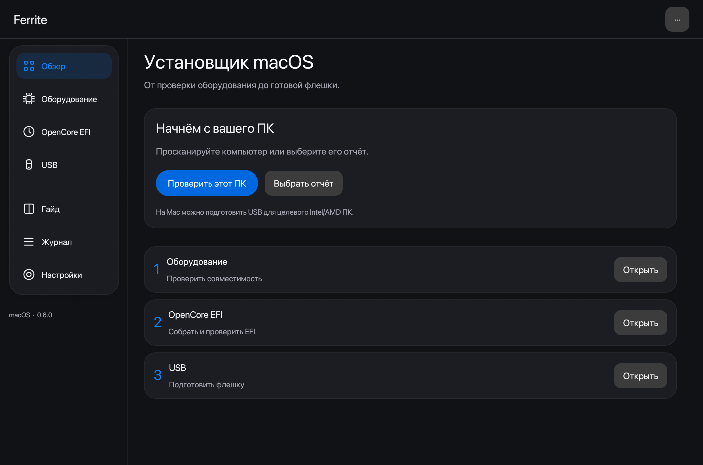
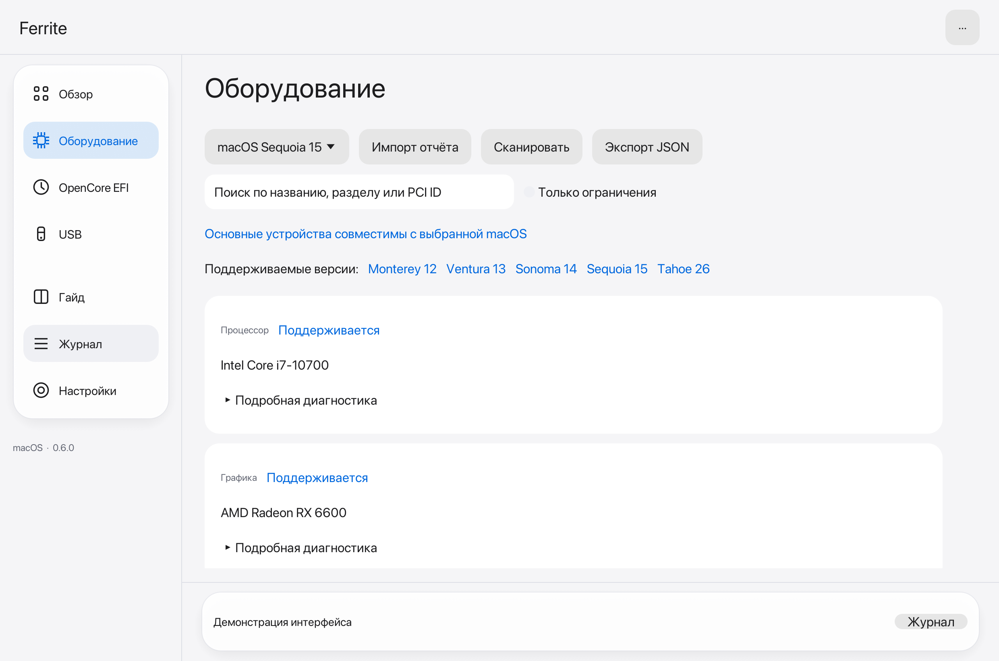
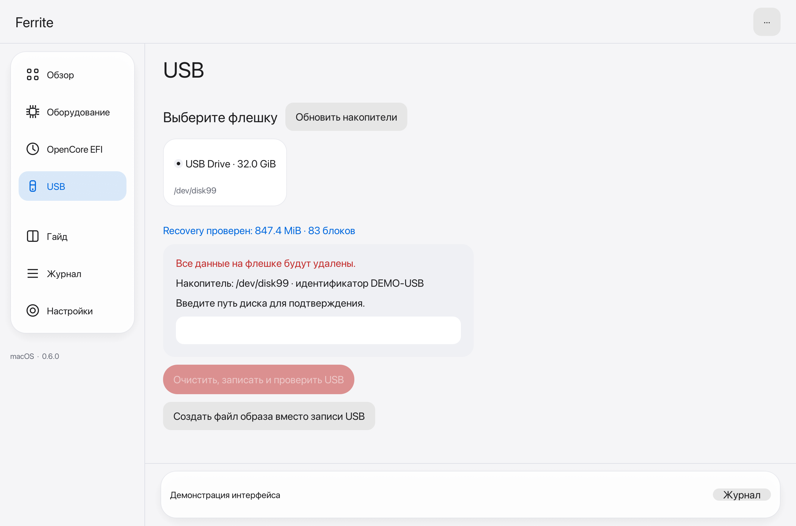

# Ferrite 0.6.0

Интерфейс в стиле Apple: крупная типографика, округлённые карточки, полупрозрачная навигационная поверхность и один синий акцент. На macOS используется установленный системный шрифт. Это собственный кроссплатформенный интерфейс egui; системный материал Liquid Glass и SF Symbols не встраиваются.

Выберите «Настройки → Оформление»: системная, светлая или тёмная тема. Выбор сохраняется. В небольшом окне навигация переносится наверх. Команды доступны через меню «···» и Ctrl+Shift+P / ⌘⇧P.

На главном экране три этапа: оборудование, OpenCore EFI, USB. Технические идентификаторы, полный диагноз, состав EFI и дополнительные настройки находятся в раскрываемых блоках. Подтверждение стирания USB остаётся обязательным.

## Светлая тема


## Тёмная тема



## Оборудование



## USB



Снимки сделаны с работающего Rust-приложения на macOS. Для оборудования и USB использованы явно обозначенные демонстрационные данные; операции записи в preview отключены. Эти изображения не подтверждают совместимость показанного ПК или выполнение записи.

В Actions доступен артефакт `ui-screenshots`: восемь экранов, включая узкое окно, английский и испанский интерфейсы. Локальное воспроизведение:

```bash
cargo build -p ferrite-desktop --features screenshot --locked
python3 tools/ui/screenshots.py target/debug/ferrite ./ui-screenshots
# Linux без дисплея: xvfb-run -a python3 tools/ui/screenshots.py target/debug/ferrite ./ui-screenshots
```
