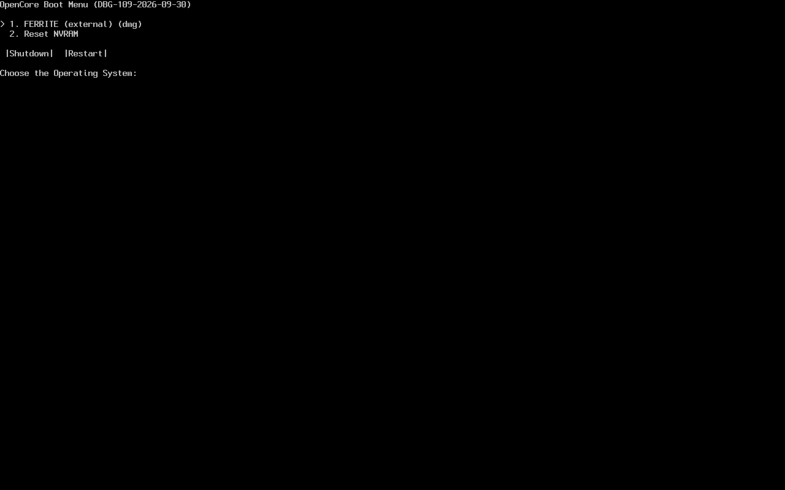

# Проверка Ferrite 0.2.0

Проверено в Linux-среде разработки 12 октября 2026. Эти результаты относятся к конкретным входным данным, а не ко всем компьютерам.

- Rust workspace собран; автоматические тесты проверяют compatibility, ACPI, зависимости, проверку подписей/повреждений и FAT round-trip.
- Реальная сборка AMD X570 / Darwin 24: ocvalidate из закреплённого OpenCore пакета завершился без ошибок. SHA-256 отчёта: b96bc8ac204e076813e79205c9f3a2f83743ef567202301a65b78586d5557914.
- Sequoia Recovery, Apple product 093-10615: скачано 888615275 байт; RSA подпись chunklist и все блоки проверены. Образ SHA-256: c9fff24b410ae134c6be17ebd4194e0ad3d73bb839a65f8d94c93a20fe97cd1e. Chunklist SHA-256: a8917a335e9628c2fdbb8b79aa1cbd1fbce3ddae60589d1fa39d86fda30ed07.
- Создан новый sparse образ 8 GiB, MBR/FAT32: 48 файлов, 921547001 байт payload. Повторно проверены файлы в файловой системе образа.
- QEMU q35/TCG + OVMF загрузил этот образ до меню OpenCore; меню обнаружило установочный Recovery. Загрузка ядра/установка macOS этим тестом не подтверждены.
- Нативный GUI снят через Xvfb/OpenGL software rendering. Windows код проходит cross-check; запуск Windows GUI/Win32 writer не выполнялся.
- Физические диски не стирались. Apple Recovery и образ не входят в исходники.

## Ferrite 0.3: языки и гайд

Проверены три JSON-каталога, единые ключи/параметры, переключение текста, региональные локали, атомарное сохранение языка, гайд GUI/CLI и нативные скриншоты на русском, английском и испанском. Эти изменения не добавляют результатов проверки физической записи USB или Windows hardware QA.

## Ferrite 0.4: дизайн и macOS

- Нативный интерфейс в стиле редактора снят на Linux через Xvfb: обзор ru/en, гайд es, EFI ru и палитра команд en.
- macOS парсеры проверены на синтетических Intel PCI/Apple Silicon данных: endian PCI ID, обязательное различение ARM/x86, недопустимые disk identifiers, отсутствие/повреждение ACPI. Эти тесты не заменяют аппаратные отчёты настоящих Mac.
- macserial и ocvalidate из SHA-256-проверенного OpenCore пакета имеют Mach-O universal header с CPU types 0x01000007 (Intel) и 0x0100000c (ARM64).
- Python-упаковщик и CI YAML проверены синтаксически. Нативный macOS запуск, подпись .app и DMG в этой среде не выполнялись. Apple-target check из Linux остановился в ring/clang из-за отсутствия Apple SDK.
- В версии 0.4 физический writer macOS был отключён; создание файлов образов было доступно. Windows/Linux операции не переписаны этим изменением.

## Очистка структуры и CI

После удаления legacy-реализаций выполнены локальные проверки на macOS Apple Silicon с Rust 1.99.0: `cargo fmt --all --check`, строгий Clippy для всех workspace targets и 48 Rust-тестов. Экспорт PCI/codec/GPU таблиц воспроизводит прежние JSON без изменений; SHA-256 исходников экспортера сверены с PINNED.json. Проверены локальные ссылки документации и состав Linux/Windows архивов на тестовых файлах, включая CLI и лицензии. Это не проверка физического USB.

Workflow Ferrite проверяет обе desktop-платформы и обе архитектуры macOS; результат конкретного запуска нужно смотреть в GitHub Actions. При успешном push в main публикуется preview-релиз с четырьмя пакетами и SHA256SUMS.

## Ferrite 0.5: прямая запись macOS

Новый backend: IOKit connection identity, защита всех физических хранилищ корневого APFS, Disk Arbitration claim и запрет монтирования на время записи, проверка block-device geometry, FAT32/MBR и SHA-256 read-back, hardware-cache flush и безопасное извлечение. GUI запрашивает права через системный диалог AppleScript; аргументы передаются отдельно и экранируются `quoted form`.

Обычные тесты проверяют опасные идентификаторы, неизвестное writable-состояние, APFS/Fusion physical stores и подмену структуры разделов. Отдельный root-only тест Actions создаёт собственный HDI-образ: production writer его отвергает; test-only route проверяет native claim, запрет второго claim/монтирования, запись и повторное подключение. Test-only route не компилируется в поставляемый CLI. Успех конкретного нативного теста нужно сверять с Actions; физическая флешка пользователя этим не тестируется.

Исправлены FAT32 dot/dotdot entries в закреплённой локальной копии fatfs 0.3.6 и очистка старых сигнатур файловой системы. Регрессионный тест проверяет каталоги, длинные имена и FSInfo системной `fsck_msdos -n` на отдельном файле образа. Native Actions тест также требует успешного fsck перед монтированием записанного раздела.

Если Disk Utility в runner не монтирует исправный FAT32 после успешного fsck, тест использует системный `mount_msdos` в режиме чтения и проверяет файл через смонтированную файловую систему. Это обход проблемы CI-монтирования; production writer после записи извлекает накопитель.
